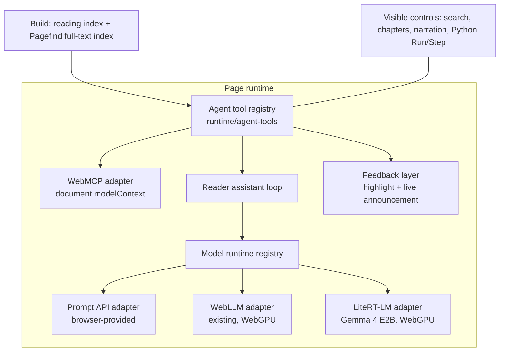

# Agent tools and in-browser models: technical and UX plan

Status: proposed on 23 October 2026; the owner accepted the plan's decisions the
same day ([§8](#8-decisions)). Phase 0 spikes are complete
([§9](#9-phase-0-results)). Phase 1 (search and reading index) is implemented
and tested locally, not deployed
([architecture](architecture.md#search-and-reading-index)); later phases are not
implemented. It builds on the
[WebMCP research](webmcp-research.md) and extends the existing browser-model
rules in [architecture §6](architecture.md#6-browser-experiments). Site-wide
search and a reader assistant, previously deferred in
[product design](product-design.md), are now accepted, planned scope.

## 1. What is worth doing

| Capability                                         | Who benefits                                                  | Reach (October 2026)                                          | Verdict                                                                               |
| -------------------------------------------------- | ------------------------------------------------------------- | ------------------------------------------------------------- | ------------------------------------------------------------------------------------- |
| Static full-text search                            | Every reader                                                  | All browsers, no model                                        | **Do first.** Also the retrieval layer for agents and the assistant                   |
| Shared agent tool registry                         | Agents, the site's own assistant, tests                       | Code is browser-independent                                   | **Do.** Small, and every later option reuses it                                       |
| WebMCP adapter (read/navigate tools)               | Visitors using ChatGPT desktop, Gemini in Chrome (2027), etc. | Chromium behind flag or origin trial                          | **Do as a labelled experiment**, feature-detected, with Chrome and Edge trial tokens  |
| Agent-operable Python activities                   | Readers learning with an agent beside them                    | Same as WebMCP                                                | **Do.** The most distinctive tool set for these books                                 |
| Browser-provided model adapter (Prompt API)        | Model experiments without a separate download                 | Chrome desktop 148+ with capable hardware; Edge Canary/Dev    | **Do**, small change to the existing runtime registry                                 |
| Reader assistant (“Ask about this page”)           | Readers on capable devices                                    | Chrome desktop, Edge preview, or WebGPU with a ~2 GB download | **Do**, on all reading pages, labelled as a small on-device model that can be wrong   |
| Summarizer / Translator / Writer APIs in reader UI | —                                                             | Chrome and Edge                                               | **Skip.** Browsers already offer page translation and summaries; Writer suits authors |
| Model features in the local editor                 | Author                                                        | Local                                                         | **Skip.** Coding agents and the existing review tools cover this                      |
| `llms.txt`, NLWeb, `.well-known` tool manifests    | —                                                             | —                                                             | **Skip** (see research)                                                               |

## 2. Principles

These extend the existing rules for experiments and models; none replaces them.

1. **Static first.** Pages, books and exports stay complete without JavaScript,
   models or agents. Nothing here changes book output.
2. **No download during reading.** Model files, including a browser's built-in
   model, are downloaded only after an explicit reader action that states the size.
3. **Local only, no cloud fallback.** Questions, page text and tool results never
   leave the device because of these features.
4. **One tool set, many callers.** WebMCP, the site's assistant and the tests call
   the same tool definitions, and each tool calls the handler a visible control
   already uses. No tool can do what the interface cannot, which answers WebKit's
   concern that a separate tool layer can drift from the page.
5. **Visible actions.** Whenever an agent acts, the page shows and announces what
   happened.
6. **Lazy and detectable.** Nothing loads unless the browser supports it: agent
   code only when `modelContext` exists, assistant code only on activation.
7. **Privacy-consistent analytics.** Only tool names and outcomes are counted,
   under the existing consent rules; never queries, prompts, code or answers.

## 3. Browser capability matrix

| Browser                  | WebMCP                           | Built-in language model                                                             | Task APIs                                       | WebGPU (WebLLM / Transformers.js)      | CPU fallback (WASM) |
| ------------------------ | -------------------------------- | ----------------------------------------------------------------------------------- | ----------------------------------------------- | -------------------------------------- | ------------------- |
| Chrome desktop           | Flag; origin trial from 149      | Prompt API (Gemini Nano) on by default since 148; tool calling not implemented yet  | Summarizer, Translator, Language Detector (138) | Yes                                    | Yes                 |
| Chrome Android           | No                               | No                                                                                  | No                                              | Android 12+ with supported GPUs        | Yes                 |
| Edge                     | Flag in Canary/Dev; origin trial | Prompt API preview in Canary/Dev (Phi-4-mini; Aion-1.0-Instruct on CPU, prerelease) | Translator, Language Detector (148)             | Yes                                    | Yes                 |
| Brave and other Chromium | Brave Nightly flag               | No (Gemini Nano ships only in official Chrome)                                      | No                                              | Yes                                    | Yes                 |
| Firefox                  | Hidden prototype, off            | No; Mozilla opposes the Prompt API. Extension-only `browser.trial.ml` API           | No                                              | Windows (141), Apple silicon Mac (145) | Yes                 |
| Safari                   | No; WebKit opposes WebMCP        | No web API                                                                          | No                                              | Safari 26 on macOS, iOS, iPadOS        | Yes                 |

Notes:

- **Prompt API requirements (Chrome):** Windows 10/11, macOS 13+, Linux or
  Chromebook Plus; 22 GB free disk; more than 4 GB VRAM, or 16 GB RAM and 4 cores
  for the CPU build; unmetered network for the first download. Input languages:
  English, Japanese, Spanish, German, French. Not exposed in Workers. Developers
  must acknowledge Google's Generative AI Prohibited Uses Policy. The browser does
  not report which model version answered.
  ([Chrome docs](https://developer.chrome.com/docs/ai/prompt-api),
  [Edge docs](https://learn.microsoft.com/en-us/microsoft-edge/web-platform/prompt-api))
- **Built-in models are shared** across sites and downloaded once by the browser
  (about 2.7–4 GB), so a reader may already have one. WebLLM and LiteRT-LM
  models are per-origin downloads.
- **WebNN** is still an origin trial; keep it as a future adapter.

## 4. Architecture



### 4.1 Reading index and search (phase 1, implemented locally)

Implemented and tested locally on 23 October 2026; details in
[architecture](architecture.md#search-and-reading-index).

- **Reading index.** `/reading-index.json`, generated at build from the compiled
  site: published pieces with summaries, tags, linkable sections and book
  placements, and books with ordered contents and URLs. No body text; drafts are
  not in production builds. Root-relative URLs plus a `base` field.
- **Full-text search.** [Pagefind](https://pagefind.app/) 1.5.2 indexes the built
  HTML after `astro build` and ships a WASM client and chunked index loaded on
  demand. Only reading text marked `data-pagefind-body` is indexed. Book chapter
  pages declare the book as their canonical URL, so canonical URLs cannot pick
  the result: a piece that is also a standalone article is found as the article,
  whose result names its books ("Article · also in …"); other book pieces are
  found at their reading page. Combined chapter pages, archive and original-site
  copies are not indexed.
- **Search UI.** A masthead Search link opens `/search/`; `/` opens it from any
  page unless the reader is typing. The planned in-page dialog was not built: one
  page keeps a single accessible search surface and works as a plain link. The
  form is a real `GET` form; without JavaScript a note points to the writing
  list. Results show title, context, date and a highlighted excerpt.
- **Declarative WebMCP.** The form carries `toolname="search_writing"`,
  `tooldescription`, `toolparamdescription` and `toolautosubmit` (search is
  read-only, and phase 0 showed a form without it waits for the reader to press
  Search). On an agent submission the page returns results through
  `SubmitEvent.respondWith()` instead of rendering a new page. Astro types the
  attributes through `site/webmcp.d.ts`; HTML validation does not run on built
  pages, so no allowance was needed.

### 4.2 Agent tool registry (phase 2)

A framework-independent module, `runtime/agent-tools/`, defining each tool once:

```ts
type AgentTool = {
  name: string; // ASCII, stable, e.g. "run_code_example"
  title: string;
  description: string; // written for models: what, when, limits
  inputSchema: JSONSchema; // hand-written, small, validated in tests
  annotations: { readOnlyHint?: boolean; untrustedContentHint?: boolean };
  scope: "site" | "article" | "book" | "code-activity";
  available(doc: Document): boolean; // e.g. only if the page has activities
  execute(input: unknown, ctx: ToolContext): Promise<ToolResult>;
};
```

`ToolContext` carries an `AbortSignal`, the caller (`"webmcp"` or
`"assistant"`) and the feedback layer. Results are small JSON with URLs and
section IDs, capped in size (e.g. 8 KB for text), so a model cannot be flooded.
Input is validated against the schema by a small validator; Zod stays at build
time to keep the page bundle small.

Proposed tools:

| Tool                                                   | Scope         | Calls                                     | Annotations                       |
| ------------------------------------------------------ | ------------- | ----------------------------------------- | --------------------------------- |
| `search_writing(query, limit)`                         | site          | Pagefind                                  | read-only                         |
| `list_writing(tag?, type?)`                            | site          | reading index                             | read-only                         |
| `get_book_contents(collection)`                        | site          | reading index                             | read-only                         |
| `get_page_outline()`                                   | article, book | headings and section IDs on the page      | read-only                         |
| `get_section_text(sectionId)`                          | article, book | rendered text of one section              | read-only                         |
| `open_page(url)`                                       | site          | same-origin navigation only               | not read-only (navigates)         |
| `go_to_section(sectionId)`                             | article, book | scroll and focus, as an in-page link does | not read-only (moves focus)       |
| `play_narration(fromSectionId?)` / `pause_narration()` | article, book | existing narration and audiobook players  | not read-only                     |
| `list_code_examples()`                                 | code-activity | activities on the page, with titles       | read-only                         |
| `run_code_example(id, code?)`                          | code-activity | the same path as **Run**, editor updated  | untrusted content if code changed |
| `step_code_example(id)` / `restore_code_example(id)`   | code-activity | **Step** and **Restore original**         | not read-only                     |

Deliberately excluded: loading or downloading models, saving results, sharing,
analytics consent, anything in the local editor. These involve downloads,
files or consent and stay human-only.

Python tools reuse the existing sandbox: code runs in the opaque-origin iframe
and Worker, with the 16,000-character limit, 10-second run limit and validated
recording. To support this, `mountPythonRunner` returns a small controller
(`run(code?)`, `step()`, `restore()`, a result promise) used by both the
buttons and the tools, instead of tools clicking buttons.

### 4.3 WebMCP adapter (phase 2)

- `enhance.ts` checks `document.modelContext` and only then imports the adapter,
  like simulations and code activities today. Chrome 156 no longer has the old
  `navigator.modelContext` alias ([§9](#9-phase-0-results)).
- The adapter registers tools whose `available()` is true, each with one
  `AbortController` signal so all can be removed (on `pagehide`, or when the
  reader turns agent tools off).
- It wraps `execute` to call the feedback layer and to convert errors into short,
  model-readable messages without stack traces.
- **Tool surface integrity.** First-party tools register first. The adapter
  listens for `toolchange` and logs, in development, any tool it did not
  register. PostHog, the only third-party script and loaded only after consent,
  is the main source of possible extra tools.
- **Origin trials (decided: Chrome and Edge).** Local testing uses the browser
  flag. Production registers for both the Chrome and the Edge WebMCP origin
  trials and emits one `<meta http-equiv="origin-trial">` tag per token from site
  configuration (`publishing/site.yaml`, schema-validated with browser, token and
  expiry date). Tokens are public but tied to the domain; Edge's trial currently
  lists 17 November 2026 and Chrome's runs to M156 (a reported extension is
  unconfirmed). The build warns 30 days before an expiry and omits expired
  tokens. Registration accounts and renewal dates belong in the private
  operations note.
- **No polyfill on production pages.** `@mcp-b/global` is useful for local
  experiments with MCP clients, but shipping it would add a non-standard API.

### 4.4 Model runtime extensions (phase 3)

The current contract (`runtime/contracts.ts`) assumes downloaded artifacts:
`ModelDescriptor` has URLs, byte counts and checksums. Built-in models have none
of these, so:

- Add a descriptor variant for browser-provided models, e.g.
  `{ id: "browser-language-model", runtime: "prompt-api", format: "builtin",
languages: ["en"] }`, with `downloadBytes` and `vramMB` absent. `models.json`
  validation accepts both variants.
- New adapter `runtime/adapters/prompt-api.ts` implementing `ModelRuntime`:
  - `probe` calls `LanguageModel.availability({ expectedInputs, expectedOutputs })`
    and maps `unavailable`, `downloadable`, `downloading` and `available` without
    starting a download.
  - `load` calls `LanguageModel.create({ monitor, signal, initialPrompts })` only
    after the reader confirms, and reports `downloadprogress`.
  - `run` uses `promptStreaming`; `reset` clones from the initial session;
    `dispose` destroys it; `clear` cannot delete a browser model, so the UI
    explains where the browser manages it.
- New adapter `runtime/adapters/litert-lm.ts` for
  [`@litert-lm/core`](https://ai.google.dev/edge/litert-lm/js) (Google's
  LiteRT-LM JS API, an early preview), runtime `litert-lm`, format `litertlm`.
  It loads `gemma-4-E2B-it-web.litertlm` (text-only, 2,008,432,640 bytes, SHA-256
  `3a08e8d9…35af35b5`) from a pinned revision of
  `litert-community/gemma-4-E2B-it-litert-lm`, with the same descriptor fields
  as WebLLM models. The WASM files are served from the site, not a CDN. `clear`
  removes the cached model file.
- Extend `ModelSession` with optional assistant methods:
  - `chatWithTools(messages, tools, signal)` for runtimes with native tool calls.
    LiteRT-LM implements it with conversation tools and
    `enableConstrainedDecoding`. Tools must be passed wrapped as
    `{ type: "function", function }`; the unwrapped form fails in 0.18.0.
  - `generateJSON(messages, schema, signal)` for runtimes without tools. The
    Prompt API implements it with `responseConstraint`.
- WebLLM keeps serving the existing model experiments; the assistant does not
  use it ([§9](#9-phase-0-results)).
- **Recorded results.** Built-in models are unversioned, so a recording stores
  `runtime: "prompt-api"`, the browser name and version, and
  `model: "browser-provided (unversioned)"`. Book examples keep using recorded
  outputs.
- Model experiments in articles gain an optional `runtimes` order, e.g.
  `[prompt-api, litert-lm, webllm]`. The experiment chooses the first available runtime and
  says which one is in use.
- Fix in passing: the WebLLM adapter reports version `0.2.85` while the lockfile
  has `0.2.86`; derive the label from the package instead.

### 4.5 Reader assistant (phase 4)

A bounded helper on every reading page (articles and book chapters, not the
archive or original-site snapshot): answer questions about the current page or
book, point to sections, and explain or run its code examples.

- **Runtime ladder (decided).** (1) The browser's built-in model through the
  Prompt API if available; (2) Gemma 4 E2B through LiteRT-LM (about 2 GB, chosen
  in phase 0) if WebGPU is available and the reader agrees to the download;
  (3) otherwise the assistant is not offered. No cloud model.
- **Agent loop.** One loop over the shared registry, with at most four tool calls
  per question before an answer is required. The final answer is itself a tool,
  `answer({ found, answer, citations })`, whose `citations` enum is limited to the
  section IDs retrieved so far.
  - LiteRT-LM: native tool calls with constrained decoding. The registry's tools
    are already WebMCP-shaped (`name`, `description`, `inputSchema`), which is the
    shape LiteRT-LM's own `AutoToolChat` accepts; the site keeps its own loop so
    it controls the step limit, feedback and citation filtering.
  - Prompt API: no tool calling yet, so the loop uses constrained JSON,
    `{ "action": "call", "tool": "...", "input": {...} }` or the `answer`
    object, validated and retried once on failure. When the Prompt API ships
    `tools`, it moves to the native path without changing the tools.
- **Grounding.** Answers must cite section IDs returned by tools; citations that
  were not retrieved are dropped. The system prompt says the page text is the
  authority and the assistant must say when it does not know.
- **Context budget.** Use `session.contextWindow` and
  `measureContextUsage()` where available; retrieve sections, not whole chapters.
- **Languages.** Gemini Nano accepts five input languages; the site is in
  English, so the assistant is offered only when the reader's prompt language is
  supported, otherwise it says so.

## 5. UX and UI design

### 5.1 Where things appear

| Element                        | Placement                                                                            | Shown when                                              |
| ------------------------------ | ------------------------------------------------------------------------------------ | ------------------------------------------------------- |
| Search                         | Masthead link “Search” beside the existing navigation; `/` shortcut; `/search/` page | Always (the page works without JavaScript as a link)    |
| Agent activity notice          | Inline toast at the bottom of the viewport plus highlight of the affected element    | Only when an agent calls a tool                         |
| Agent tools disclosure         | Footer: “For AI agents” link to an `/agents/` page                                   | Always; the page explains, lists tools, offers a switch |
| “Ask about this page”          | Reading tools row beside listening controls on article and book pages                | Only after a capability probe finds a usable runtime    |
| Model experiment runtime label | Inside existing experiment blocks                                                    | When more than one runtime is possible                  |

### 5.2 Agent activity feedback

Agents act on behalf of the reader, so their effects must be visible and
reversible with the normal controls:

- The affected element (a section, a code activity, the narration player) gets a
  dashed outline in the accent colour, matching the `:tool-form-active` style used
  for declarative forms, and is scrolled into view unless reduced motion is set.
- A small notice reads, for example, “An AI agent ran ‘Counting tallies’” or
  “An AI agent opened Chapter 2”, with **Undo** where it applies (restore the
  code, return to the previous position). It is announced in an
  `aria-live="polite"` region and disappears after a few seconds or on Escape.
- The Python output and editor show the agent's code exactly as if the reader had
  typed it; **Restore original** works as usual.

### 5.3 “For AI agents” page

A short page in the site's voice explaining that the site offers tools to
browser agents, what each tool does, that tools only read the site or operate
visible controls, and that nothing is sent anywhere by the site. It includes a
**Turn off agent tools on this device** switch stored in `localStorage` (wrapped
in try/catch, default on). It also states which browsers support this today.

### 5.4 Reader assistant panel

- **Entry.** A quiet text button with an icon, “Ask about this page”, in the
  existing reading-tools style. No sparkle iconography or promotional copy.
- **Panel.** A non-modal side panel on wide screens (the article reflows to keep
  a comfortable measure) and a bottom sheet on narrow screens. It is a labelled
  `<aside>`, not a focus trap, so reading and listening continue. Escape closes
  it and returns focus to the button.
- **Before first use.** A plain explanation of what will happen, depending on the
  runtime:
  - Built-in model available: “Runs on this device using your browser's built-in
    model. Your questions stay in this browser.” → **Start**.
  - Built-in model downloadable: “Your browser can download its built-in model
    (about 3–4 GB, shared with other sites). This happens once.” →
    **Download and start** / **Not now**.
  - Downloadable model: model name (Gemma 4 E2B), size from the descriptor and a
    storage note → **Download (about 2 GB)**, with progress and **Cancel**, and
    **Clear downloaded model** later.
- **Conversation.** Three or four suggested questions generated from the page
  outline (“What problem does this chapter solve?”, “Run the first example and
  explain the output”). Answers stream; each tool step appears as a compact line
  (“Read section ‘Binary search’”, “Ran example 2”) linking to the section.
  Citations are section links that scroll to and highlight the passage.
- **Honesty.** A persistent one-line note: “A small model running on your device.
  It can be wrong; the text is the reference.” **Stop** during generation,
  **New conversation** to reset. Conversations are not stored after the page
  closes.
- **Failure states.** Unsupported language, context full (“This question needs
  more of the chapter than the model can read at once; try a narrower
  question.”), model removed by the browser, download failed. Each state says
  what still works (search, the text, the examples).
- **Accessibility.** All controls are real buttons with visible labels; streaming
  text is announced on completion rather than token by token; contrast and focus
  styles follow the theme; the panel works at 200% zoom and with keyboard only.

## 6. Privacy, safety and policy

- Page content and tool results are first-party, so `untrustedContentHint` is
  needed only where reader-edited code produces output.
- No consequential actions are exposed; the worst an agent can do is navigate,
  play audio or run sandboxed Python, all undoable.
- Analytics events, only after consent: `agent_tool_called` (tool name, caller,
  success) and `assistant_started` (runtime). Update
  [analytics and privacy](analytics-and-privacy.md) before adding them.
- Using the Prompt API requires acknowledging Google's Generative AI Prohibited
  Uses Policy; record that acknowledgement in the documentation for this feature.
- The “For AI agents” page and the assistant panel disclose model use and limits.

## 7. Delivery plan

| Phase                       | Scope                                                                                                   | Size | Exit criteria                                                                                                              |
| --------------------------- | ------------------------------------------------------------------------------------------------------- | ---- | -------------------------------------------------------------------------------------------------------------------------- |
| 0. Spikes (done)            | WebMCP flag in Chrome and Edge; Prompt API probe and JSON constraints; one downloadable assistant model | S    | Feature names, flags and Playwright launch options confirmed; model choice recorded                                        |
| 1. Index and search (done)  | Reading index, Pagefind, search page and `/` shortcut, declarative tool attributes                      | M    | Search works in Chrome, Firefox, Safari; no-JS fallback; validate passes; index excludes drafts                            |
| 2. Tool registry and WebMCP | Registry, Python controller refactor, adapter, feedback layer, `/agents/` page                          | M    | Tool Inspector lists and runs every tool; unit tests with a fake `modelContext`; no change for browsers without WebMCP     |
| 3. Model runtimes           | Descriptor variant, Prompt API and LiteRT-LM adapters, runtime order, recording changes                 | S    | Existing WebLLM experiment unchanged; Prompt API path verified on a capable Chrome; unsupported paths show static results  |
| 4. Assistant                | Loop, panel, grounding, evaluation set covering every published piece                                   | L    | Evaluation questions for each published piece answered with valid citations at an agreed rate; manual accessibility review |
| 5. Production enablement    | Chrome and Edge origin-trial tokens, release notes                                                      | S    | Deployed and verified; token expiry warning in build                                                                       |
| 6. Article                  | Write-up based on observed agent and model behaviour after release                                      | M    | Draft reviewed through the normal editorial workflow; linked from the “For AI agents” page once published                  |

### Testing

- **Unit (node:test):** schemas, validation, size caps, `available()` rules, the
  agent loop with a scripted fake model, citation filtering.
- **Browser (Playwright):** search and declarative form in all engines; WebMCP
  tools in installed Chrome (`channel: "chrome"`) launched with
  `--enable-features=WebMCPTesting`, skipped when Chrome is not installed (the
  Puppeteer headless shell used by other tests has no WebMCP); a mocked
  `LanguageModel` for the assistant UI states.
  Real Prompt API and LiteRT-LM runs cannot happen in CI and are recorded as manual
  verification in [verification](verification.md).
- **Bundle budget:** pages without WebMCP or activation load no extra code beyond
  the feature checks.

### Documentation to update during implementation

[Architecture §6](architecture.md#6-browser-experiments) (runtime variants, tool
registry), [product design](product-design.md) (search and assistant move
from planned to implemented), [code activities](code-activities.md) (agent operation),
[analytics and privacy](analytics-and-privacy.md), [authoring
format](authoring-format.md) (experiment runtime order),
[implementation status](implementation-plan.md) and
[verification](verification.md).

## 8. Decisions

Accepted by the owner on 23 October 2026:

1. **Search:** static full-text search with Pagefind is a reader feature in its
   own right, independent of agents.
2. **WebMCP:** ship the tools on the deployed site with origin-trial tokens for
   both Chrome and Edge, not only for browsers with the flag.
3. **Assistant scope:** all reading pages (articles and book chapters).
4. **Assistant models:** the browser's built-in model first, then an explicit
   download of Gemma 4 E2B (LiteRT-LM, about 2 GB) on WebGPU browsers; never a
   cloud model. The owner chose Gemma 4 E2B over the smaller Qwen3 1.7B after
   the phase 0 comparison ([§9](#9-phase-0-results)).
5. **Article:** write it after the features ship, from real observations; until
   then the “For AI agents” page is the public explanation.

Settled in phase 0: the downloadable assistant model is Gemma 4 E2B on
LiteRT-LM ([§9](#9-phase-0-results)).
Still to settle: the citation-accuracy threshold for the assistant evaluation
(phase 4).

## 9. Phase 0 results

Run on 23 October 2026 on an Apple M1 Pro (16 GB) with Chrome 156.0.8078.48 and
Playwright 1.64. Edge is not installed on the test machine; its WebMCP checks
wait for phase 5. Spike scripts were throwaway and are not in the repository.

**WebMCP (Chrome 156).**

- `--enable-features=WebMCPTesting` (and also `WebMCP`, the Blink feature or
  experimental web platform features) exposes `document.modelContext` with
  `registerTool`, `getTools`, `executeTool` and `ontoolchange`. Without a flag it is
  absent. `navigator.modelContext` does not exist, and `window.ontoolactivated` /
  `window.ontoolcancel` are gone.
- `registerTool(tool, { signal })` resolves to `undefined`; aborting the signal
  unregisters the tool; `toolchange` fires for both.
- `getTools()` returns plain objects with `name`, `title`, `description`,
  `inputSchema`, `annotations` (all four hints, defaulted to `false`), `origin` and
  `window`. A declarative form appears with a schema inferred from input `name`,
  `toolparamdescription` and `required`.
- `executeTool(toolObject, inputObject)` takes the object from `getTools()` and an
  input object (a JSON string is rejected) and resolves to the JSON-serialised
  result. A declarative form without `toolautosubmit` must have a submit button.
- `SubmitEvent.agentInvoked`, `SubmitEvent.respondWith`, `:tool-form-active` and
  the `tools` Permissions Policy are present.
- The Puppeteer headless shell (Chromium 155) has no WebMCP even with flags, so
  WebMCP browser tests use installed Chrome.

**Prompt API.** `LanguageModel` and `Summarizer` exist in Chrome 156, but in a
fresh automated profile both report `unavailable`, even with Playwright's
component-update and feature-disabling defaults removed and after 90 seconds:
the on-device page never finishes classifying the device. Real built-in model
behaviour, including `responseConstraint`, is therefore manual verification on
the owner's everyday Chrome; automated tests use a mocked `LanguageModel`.

**Downloadable model choice.** Each model answered 8 tool-routing requests
(including two that must be refused) and 16 grounded questions over real site
sections (12 answerable, each with the gold section and two decoys from the same
page in rotating order; 4 unanswerable). Output was schema-constrained; citations
could only be section IDs that were provided. Indicative only: the set is small.
WebLLM 0.2.86 models used a JSON-schema response format; the LiteRT-LM run used
native tool calls with constrained decoding (`@litert-lm/core` 0.18.0).

| Model                       | Storage | Routing | Valid JSON | Found / cites gold | Abstains | Median answer |
| --------------------------- | ------: | ------: | ---------: | -----------------: | -------: | ------------: |
| Gemma 4 E2B web, LiteRT-LM  | 2008 MB |     6/8 |      16/16 |      12/12 · 12/12 |      4/4 |         3.9 s |
| Gemma 4 E2B q4f16_1, WebLLM | 2842 MB |     5/8 |      16/16 |        8/12 · 4/12 |      3/4 |        15.1 s |
| Qwen3 1.7B                  |  986 MB |     6/8 |      16/16 |        9/12 · 8/12 |      4/4 |         4.2 s |
| Qwen3.5 2B                  | 1080 MB |     6/8 |      15/16 |       10/12 · 8/12 |      4/4 |         7.0 s |
| Qwen2.5 1.5B Instruct       |  882 MB |     5/8 |      16/16 |       12/12 · 9/12 |      1/4 |         4.9 s |
| Qwen3.5 0.8B                |  444 MB |     5/8 |      16/16 |        5/12 · 9/12 |      3/4 |         5.1 s |
| Llama 3.2 1B Instruct       |  711 MB |     4/8 |      13/16 |        1/12 · 4/12 |      0/4 |         2.6 s |
| Gemma 3 1B                  |  603 MB |     2/8 |      13/16 |        1/12 · 2/12 |      3/4 |         3.9 s |

The WebLLM rows are q4f16_1 builds. Decision: **Gemma 4 E2B, Google's
text-only web build on LiteRT-LM** (Apache-2.0, not gated). Every answer was
correct and cited only the gold section, it declined every unanswerable
question, and its two routing misses chose search for topics not named in a
heading, which is the better behaviour; Qwen models guessed a wrong section
instead. It loaded in 6 seconds from a local file. The cost is a 2 GB download
(about 1.8 GB of GPU memory per Google's card) and an early-preview runtime that
supports only the Gemma 4 web builds. The same model through WebLLM includes the
vision and audio encoders and scored far lower, so the gain comes from the web
build and native tool calling, not size alone. Qwen3 1.7B on WebLLM (986 MB) was
the best of the smaller models and remains the fallback if LiteRT-LM proves
unusable in Safari or Firefox (to verify in phase 3).

Gemma 4 E2B's "0.8 GB" figure refers to memory for text-only weights on native
runtimes, which memory-map a further 1.12 GB of per-layer embeddings; every
download format is about 2 GB (GGUF QAT 2.2 GB, ONNX QAT 2.3 GB, MLX 2.4 GB).

Implementation notes from the spike:

- WebLLM compiles `json_object` schemas with unlimited whitespace and offers no
  option to change it; Gemma looped on whitespace until compact JSON was forced.
  Generate a compact grammar from each schema instead.
- Qwen3-family output starts with an empty `<think></think>` block even with
  thinking disabled, and the grammar was not reliably enforced (one reply was
  prose). Strip, validate and retry.
- WebLLM 0.2.86's prebuilt Gemma 3 1B record sets both a context window and a
  sliding window and fails to load without an override.
- WebLLM's official function-calling list only contains 7–8B models.
- LiteRT-LM 0.18.0 rejects tools passed as bare function declarations ("Failed
  to apply template: undefined value"); wrap them as `{ type: "function",
function }`. Two unanswerable replies put the literal text "false" in
  `answer`; the UI should write its own not-found message when `found` is false.
